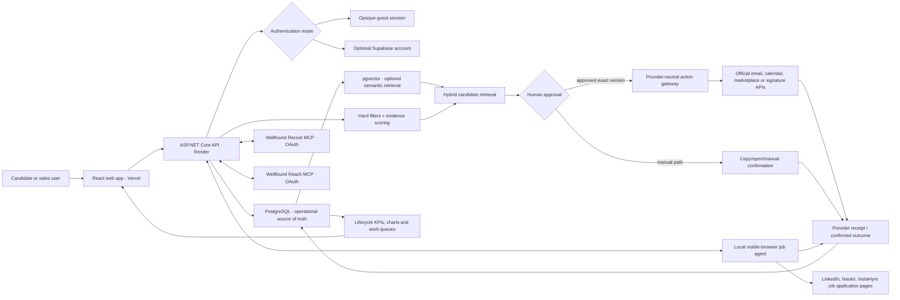
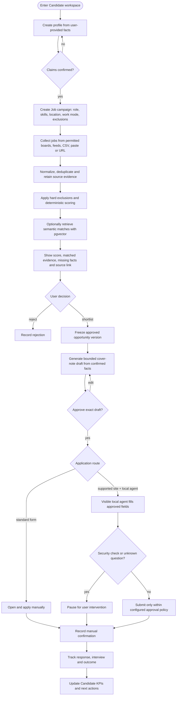

# Plans and status

Product flow, implementation status and the larger plans, merged on 2026-10-19. The live task list is `TASKS.md` in the workspace.

Contents:
- [PRODUCT_EXECUTION_FLOW.md](#product-execution-flow-md)
- [IMPLEMENTATION_STATUS.md](#implementation-status-md)
- [STAFFING_SALES_INTEGRATION_PLAN.md](#staffing-sales-integration-plan-md)
- [VECTOR_SEARCH_PLAN.md](#vector-search-plan-md)

---

## PRODUCT_EXECUTION_FLOW.md

<!-- merged from docs/PRODUCT_EXECUTION_FLOW.md on 2026-10-19 -->

## OpportunityPilot product execution flow

Status: implementation map and operator contract. The repository copy is authoritative; an editable FigJam publication
still requires access to the destination Figma workspace.

### Product boundary

OpportunityPilot is one evidence-led workflow with two workspaces:

- **Candidate** finds suitable jobs, explains the match, requires approval, assists with applications and tracks outcomes.
- **Sales** finds suitable buyers/projects, explains the fit, requires approval, prepares outreach or bids, manages the
  resulting deal, and coordinates candidate submissions through interview, offer and contract.

The system may research, rank, draft, schedule and execute an action only through an explicitly supported provider.
It never treats a draft, copied message or uncertain provider response as a completed external action.

### Shared system architecture



The local agent is a Candidate application helper running on the user's computer. It is not a server-side LinkedIn
scraper and is not the Sales outreach mechanism. Sales LinkedIn actions remain manual unless an approved official
capability explicitly permits them.

### Candidate execution



### Staffing-sales execution

```mermaid
flowchart TD
  A(["Enter Sales workspace"]) --> B["Define services, roles, regions, proof, capacity and rate cards"]
  B --> C["Launch Customer, Partner, Investor or Freelance campaign"]
  C --> D["Discover demand from approved API/feed, licensed intelligence, CSV or user input"]
  D --> E["Resolve account/contact, deduplicate and retain source evidence"]
  E --> F["Apply ICP filters, evidence scoring and optional semantic retrieval"]
  F --> G{"Sales owner decision"}
  G -->|reject| H["Record reason"]
  G -->|shortlist| I["Create or link account, contact and deal"]
  I --> J["Prepare connection note, email, proposal or marketplace bid"]
  J --> K{"Approve exact recipient, content, rate and attachment version?"}
  K -->|edit| J
  K -->|yes| L{"Official provider supports execution?"}
  L -->|yes| M["Execute once with idempotency key"]
  L -->|no| N["Copy/open/manual send and confirmation"]
  M --> O{"Receipt confirmed?"}
  N --> O
  O -->|no or uncertain| P["Keep Unknown / Needs attention; do not retry blindly"]
  O -->|yes| Q["Advance deal and schedule follow-up"]
  Q --> R["Capture reply and manage conversation"]
  R --> S["Approve calendar invitation or scheduling link"]
  S --> T["Confirm requirement and choose company candidates"]
  T --> U["Apply candidate consent and field/document sharing choices"]
  U --> V["Freeze and approve candidate submission package"]
  V --> W["Deliver package and record receipt"]
  W --> X["Create interview rounds and candidate-visible updates"]
  X --> Y["Record client/candidate feedback and decision"]
  Y --> Z["Track candidate offer, commercial offer and start date"]
  Z --> AA["Prepare, approve and sign contract"]
  AA --> AB(["Won / Lost / On hold with complete audit"])
```



### Execution controls at every external action

1. Resolve the owner, workspace and exact source entity.
2. Verify recipient/contact facts; never invent an address or profile.
3. Apply suppression, consent, quota and provider-policy checks.
4. Bind approval to the exact content, recipient, commercial terms, attachments and version.
5. Use an idempotency key for provider execution.
6. Store provider receipt, explicit manual confirmation, or `Unknown`; never infer success.
7. Write an immutable activity and update the next action.
8. Derive dashboards from stored lifecycle events, not from optimistic UI state.

### KPI flow

Candidate charts derive sourced, qualified, shortlisted, applied, replied, interviewed and offered counts plus conversion
and ageing. Sales charts derive lead, contacted, replied, qualified, meeting, submission, interview, offer, placement and
contract counts plus conversion, source, owner, response time, ageing and value. A KPI changes only after the underlying
event is stored.

### Current integration boundary

| Area | Current product route | Needed for live provider execution |
|---|---|---|
| Candidate public research | Supported public boards/feeds plus imports | Provider keys only for optional sources |
| Candidate LinkedIn/Naukri/InstaHyre apply | Local visible-browser adapters exist | First real selector validation and user login |
| Sales LinkedIn | Draft + manual copy/open/send policy | Approved LinkedIn product/partner access for any API execution |
| Upwork/Freelancer bid | Draft, approval model and manual/API boundary | Approved provider API/MCP credentials and scope |
| Wellfound Recruit | Official MCP identified; connector not yet configured | Eligible Recruit Pro company, assigned Pro seat, recruiter permission and OAuth |
| Wellfound Reach | Official separate MCP identified; connector not yet configured | Reach organization membership, role permission and OAuth |
| Email | Internal exact-version drafts | Gmail or Microsoft OAuth connection |
| Calendar | Planned approved meeting workflow | Google or Microsoft OAuth connection |
| Signature | Planned contract lifecycle | Approved e-signature provider connection |
| Vector search | Architecture ready; no migration applied | Embedding provider/model choice and pgvector rollout |

See [STAFFING_SALES_INTEGRATION_PLAN.md](STAFFING_SALES_INTEGRATION_PLAN.md) for the provider policy and implementation
order, and [VECTOR_SEARCH_PLAN.md](VECTOR_SEARCH_PLAN.md) for the bounded semantic-search design.

---

## IMPLEMENTATION_STATUS.md

<!-- merged from docs/IMPLEMENTATION_STATUS.md on 2026-10-19 -->

## Implementation status

Backend repository (`OpportunityPilotWebApi`). Milestones follow the implementation plan §20.
"Verified" means the commands below were run and passed in this repository; anything not run is called out.

Last updated: 2026-10-06.

| Milestone | Status | Notes |
|---|---|---|
| M0 Inspect, scaffold | Done (earlier sessions) | Solution, Clean Architecture layers, health endpoints, ProblemDetails, demo mode |
| M1 Auth, database, profiles | Guest mode done; hosted account flow awaits optional configuration | Durable hashed opaque guest sessions need no auth provider; Supabase JWT/JWKS (RS256/ES256/EdDSA; isolated opt-in HS256 legacy support), dev-bypass guard, GUID owner subjects, owner-scoped profiles, SqlServer + Postgres migrations. Browser signup/sign-in/refresh/reset hardening is in the web repo; live Supabase account verification still needs production keys |
| M2 Campaigns and source imports | **Done (verified)** | Job and Customer only; Partner/Investor/Freelance return 400 until M7 |
| M3 Research pipeline and scoring | **Done (verified locally)** | Live fetching of real public internet pages was not exercised (tests use a loopback server and stubbed handlers) |
| M4 Shortlist, Gemini, manual AI recovery | In progress | Deterministic CoverNote template and user approval are built; Gemini goal preview and draft rewrite (CON8, suggestion only, unit-tested with a fake client; not live-verified against Gemini) are built; manual AI exchange is not |
| M5 Outreach and pipeline tracking | In progress | Versioned CoverNote persistence and agent handoff are built; other outreach channels, inbox and follow-ups are not |
| M6 Gmail | Not started | |
| M7 Partner, Investor, Freelance modes | In progress | Manual sales project/bid/approve API plus provider migrations exist; campaign mode, Freelancer/tender providers, and the Sales UI are not wired |
| M8 Mongo archive, scheduled research | Not started | The in-process processor is not a scheduler (plan §18, §29) |
| M9 Deployment readiness | Not started for this slice | `render.yaml` and the Dockerfile exist from M0; the research slice has not been deployed |

### M2 + M3: what exists

Design spec: `docs/RESEARCH_CONTRACT.md`. What exists now: [api-contracts.md](api-contracts.md), [db-schema.md](db-schema.md).

- Domain — `src/OpportunityPilot.Domain/Campaigns/Campaign.cs`; `Research/` (`Source`, `SourceItem`, `ImportBatch`,
  `ResearchJob` with lease/claim/cancel rules, `ResearchEvent`, `Evidence`, enums); `Opportunities/` (`Opportunity`
  — research never touches `Status` — `Activity`, `OpportunityEvidence`, enums).
- Persistence — `src/OpportunityPilot.Infrastructure/Persistence/AppDbContext.cs`, `ProviderContexts.cs`
  (jsonb on Postgres; filtered unique indexes for `(SourceId, ExternalId)` and one active job per campaign).
  Migration `AddResearchPipeline` in both sets (`Migrations/SqlServer/20261001105144_…`, `Migrations/Postgres/20261001105153_…`); both only create tables and indexes.
- Application — `Campaigns/` (service, criteria, weights), `Sources/` (service, paste parser), `Imports/`
  (RFC 4180 reader/writer, preview/commit), `Research/` (`ResearchService`, `ResearchRunner`, `ResearchOptions`,
  candidates and dedupe keys, `Rules/JobRules.cs`, `Rules/CustomerRules.cs`, `Rules/Scoring.cs`, `Rules/TextMatch.cs`),
  `Opportunities/` (list/detail/status/export), `Agents/AgentResearchService.cs`; `Applications/ApplicationService.cs`
  now moves a reported opportunity to Applied.
- Infrastructure — `Research/SafeFetcher.cs` (connect-callback DNS validation, manual redirects, caps, retries),
  `Research/FetchAddressPolicy.cs` (address classifier), `Research/ContentParser.cs` (AngleSharp 1.8.3, RSS/Atom with DTDs prohibited).
- API — `Controllers/CampaignsController.cs`, `SourcesController.cs`, `ImportsController.cs`, `ResearchJobsController.cs`,
  `OpportunitiesController.cs`, `AgentResearchController.cs` (agent key only), `OverviewController.cs` (adds `campaigns`, `shortlisted`);
  `Hosting/ResearchProcessor.cs` (BackgroundService, `Research:ProcessorEnabled`).
- Capabilities — `csv-import`, `public-urls`, `feeds`, `rules` report Ready.

### Verification (run 2026-10-01)

| Command | Result |
|---|---|
| `dotnet build --no-incremental` | 0 warnings, 0 errors |
| `dotnet test` | Unit 225 passed / 0 failed; Integration 42 passed / 0 failed (Postgres 17 via Testcontainers, Docker 29.7) |
| `dotnet ef migrations add AddResearchPipeline …` (SqlServer and Postgres contexts) | Generated; reviewed: create-table/create-index only |
| `dotnet ef database update --context SqlServerAppDbContext` on a scratch LocalDB database, then `database drop` | All three SqlServer migrations applied; scratch database dropped |

Postgres migrations are applied by every integration test run (`Database:MigrateOnStartup` in the test factory). The current
sales migration has been generated for both providers; a Docker-backed migration/integration run is still required.

Integration coverage for this slice: Job research over pasted postings (Qualified / Excluded / NeedsVerification,
scores, coverage, evidence links, reasons); rerun without duplicates keeping Shortlisted; CSV preview errors, commit,
re-import without duplicates; Customer scoring (the plan's 65/100 example); export formula neutralisation; two-user
ownership (404s); stale campaign edit (409); cancel queued and cancel running; two processors racing; expired-lease
reclaim without duplicates; poison job failed after 3 attempts; run limits and result limit; agent flow (campaigns →
postings → research → shortlist → report Applied); agent-key/user-token separation; blocked addresses (literal IPs,
IPv4-mapped IPv6, metadata, `localhost`) failing safely with a loopback server proving no connection is made; feed and
page fetching over real sockets from a loopback server; demo mode (InMemory) with the real background processor.

### Not verified / known gaps

Tracked with owners and priorities in [open-questions.md](open-questions.md): real-internet fetching (OQ-BE-005),
evidence excerpt windows (OQ-BE-015), the in-process processor not being a scheduler (OQ-BE-023), rate limiting and
research quota (OQ-BE-021), live LinkedIn/Naukri selectors (OQ-BE-001) and deployment of this slice (OQ-BE-013).

### Beyond the plan (user decisions)

- **Local desktop agent** (`agent/`, owned by another engineer) applies to jobs on LinkedIn/Naukri from the user's own
  logged-in browser. The API side — `POST /api/v1/applications/report`, `/api/v1/applications`, agent keys — predates
  this slice.
- **Agent as research source and applier** (2026-10-01): `/api/v1/agent/campaigns`, `/agent/campaigns/{id}/postings`,
  `/agent/shortlist`, and `opportunityId` on reports. Only jobs the user shortlists are offered to the agent.

- **Call and schedule, API part** (2026-10-15, branch `feature/call-and-schedule`, unit-tested only, not deployed): optional
  `Phone` on staffing contacts (+ `PUT /api/v1/staffing/accounts/{accountId}/contacts/{contactId}`, migration
  `AddStaffingContactPhone` for both providers); the calendar feed also lists the candidate's `Scheduled` job interviews; the voice
  assistant can propose a `schedule` action matched to the person's own deal or job (nothing saved by the assistant); and
  `POST /api/v1/sample-data` creates marked demo records once per owner. Web side (Call button, schedule form, voice confirm) is
  separate.

### Exact next task

Wire the React app's campaign, source, import, research-progress and opportunity screens to these endpoints
([api-contracts.md](api-contracts.md)) and run one end-to-end smoke test in Development: profile → Job campaign → paste source →
research → shortlist → agent report. Then start M4 (Gemini request parsing and evidence summaries with rules fallback).

> Docs audit 2026-10-05: according to the workspace HANDOFF the web screens and the end-to-end check were done on
> 2026-10-01, and the next slice is M4 + M5 ([M4_M5_CONTRACT.md](M4_M5_CONTRACT.md), not built — OQ-BE-006). This file
> has not been re-verified since 2026-10-01 (OQ-BE-013).

---

## STAFFING_SALES_INTEGRATION_PLAN.md

<!-- merged from docs/STAFFING_SALES_INTEGRATION_PLAN.md on 2026-10-19 -->

## Staffing-sales integration plan

Status: X1 complete; X2–X12 and X14 implemented. This plan is the implementation contract for turning the Sales workspace into a
staffing/recruitment CRM from first lead through signed contract and candidate interview.

### What "local agent" means

The existing Candidate agent is a Node/Playwright program installed on the user's own Windows computer. It opens a
visible browser that is already logged in, reads approved shortlisted job applications, stops at security checks or
unknown questions, and reports the outcome to the API. Vercel and Render do not possess the user's LinkedIn, Naukri or
InstaHyre password/cookies.

That agent is **not** the Sales integration design. It must not be extended to scrape LinkedIn profiles, send connection
requests, send InMail/messages, or start conversations automatically. LinkedIn prohibits third-party scraping and
unauthorised browser automation, including automated contact and messaging activity.

### Required business flow

1. **Define the offer** — sales maintains approved services, roles, rate cards, regions, proof, delivery capacity and
   commercial terms.
2. **Launch a campaign** — select Customer, Partner, Investor or Freelance; define ICP, buyer role, geography, skills,
   budget and hard exclusions.
3. **Discover demand** — ingest permitted public feeds, CSV/user imports, an approved sales-intelligence provider, and
   official Upwork API/MCP results. LinkedIn itself is not scraped.
4. **Qualify and shortlist** — resolve company identity, deduplicate, store source evidence, score visible criteria,
   and let the sales owner reject or shortlist.
5. **Prepare the approach** — choose a contact and channel; generate a connection note, LinkedIn/InMail message, email,
   contact-form response, proposal or marketplace bid from approved company facts and evidence.
6. **Approve the exact action** — approval binds recipient, channel, content, rate card/proposal version, attachments and
   provider cost. Editing any bound field invalidates approval.
7. **Execute or hand off** — official connectors execute only their permitted operation with idempotency and receipt.
   LinkedIn and unsupported portals use a copy/open/manual-send handoff and explicit manual sent confirmation.
8. **Manage the conversation** — inbound or manually recorded messages belong to one account/contact/deal thread. Sales
   records reply intent, next action, due time, owner and private notes.
9. **Schedule discussion** — create an approved Google/Outlook calendar event or share a scheduling link; keep invitee,
   time zone, conference link, reschedule and cancellation status.
10. **Select company candidates** — enrol internal candidates with consent and field-level sharing choices. Sales chooses
    the exact resume version, skills, proof, rate, availability and documents for one client submission.
11. **Submit candidates** — freeze an immutable submission package, deliver through an official email/provider connector
    or manual handoff, store the receipt, and notify only the selected candidates with approved information.
12. **Run interviews** — track rounds, panel, schedule, candidate instructions, attendance and client/candidate feedback.
13. **Close the commercial outcome** — track selection/rejection, candidate offer, commercial offer, start date,
    placement value, contract version and signature status.
14. **Measure the funnel** — derive every KPI from stored stage/activity events: lead, contacted, replied, qualified,
    meeting, submission, interview, offer, placement and contract.

### Provider integration boundary

| Provider or activity | Discovery/read | Draft | Execute | Required control |
|---|---|---|---|---|
| LinkedIn company/contact research | Approved LinkedIn partner capability or separate licensed sales-intelligence provider; otherwise user-entered facts/URLs only | Connection note, InMail and message drafts | Manual copy/open/send and manual status confirmation unless an approved LinkedIn API product explicitly grants the operation | No scraping, browser bot, cookie capture or silent sending |
| Upwork | Official Upwork MCP or API within the account's approved scope | Proposal and bid details | MCP/API submission only after the user explicitly confirms that exact proposal | Store Connects cost, idempotency key and provider result; never retry an uncertain submission blindly |
| Wellfound Recruit | Official remote MCP `https://wellfound.com/api/mcp` with per-user OAuth | Recruiter-owned companies/jobs, applicant evidence and résumé review | Application accept/reject/undo tools only after showing current state and obtaining action-time confirmation | Requires an eligible Recruit Pro company subscription, assigned Pro seat and recruiter permission; do not copy tokens |
| Wellfound Reach | Separate remote MCP `https://reach.wellfound.com/mcp` with per-user OAuth | Projects, recruiting agents, candidate searches/evidence and company lists | Shortlist/not-a-fit and search changes within granted role; no outreach capability | Separate authorization; no candidate contact information; keep hiring decisions under human review |
| Freelancer.com | Official API if approved; otherwise import/manual project | Proposal and bid | Approved API scope or manual handoff | Exact-version approval and provider receipt |
| Naukri/other staffing portals | Official recruiter/feed/API contract where available; otherwise import/manual entry | Message/submission package | Approved connector or manual handoff | Do not reuse candidate job-apply automation for recruiter/sales outreach |
| Gmail | Gmail OAuth API | Internal draft; optional provider draft | Send only an approved exact version | Recipient verification, suppression, idempotency and Gmail message id |
| Microsoft email | Microsoft Graph delegated OAuth | Internal draft | Send only an approved exact version | Same controls as Gmail |
| Google/Outlook calendar | Calendar OAuth API | Meeting proposal | Create/update/cancel after approval | Time zone, invitees, provider event id and change audit |
| Contact forms/tender portals | Permitted public URL plus user-supplied data | Response/proposal | Manual handoff unless an official API exists | Never claim submitted without a receipt/manual confirmation |
| E-signature | DocuSign/Adobe Sign or equivalent official API | Contract envelope preparation | Send after approval | Envelope id, signer list, document hash and final signed status |

### Source-of-truth model

- **Account** — company identity, domain, location, source references and qualification facts.
- **Contact** — person/role and permitted contact paths; no invented email, phone or LinkedIn facts.
- **Deal** — the commercial opportunity, owner, source, mode, value/currency, stage, next action and current outcome.
- **Deal activity** — immutable stage/action audit including safe human-entered notes and provider/manual receipts.
- **Conversation** — messages and call notes linked to account/contact/deal; provider data stays attributable.
- **Rate card / proposal** — versioned commercial terms whose approval is invalidated by an edit.
- **Candidate** — internal talent identity, consent and sharing preferences.
- **Submission** — immutable candidate package for one deal/client and the exact facts/documents approved for sharing.
- **Interview** — one round with schedule, participants, candidate-visible instructions and feedback visibility.
- **Offer / contract** — candidate/commercial outcome, document version, signature state and placement value.

The first implementation slice (X2) introduces owner-scoped accounts, contacts, deals and immutable deal-stage
activities. It intentionally performs no external sending. Provider execution is layered on only after this source of
truth exists.

### Deal stages

`New → Qualified → Shortlisted → OutreachApproved → Contacted → Replied → MeetingScheduled → RequirementConfirmed →`
`CandidatesSubmitted → Interviewing → Offer → Contracting → Won`

`Disqualified`, `Lost` and `OnHold` are explicit terminal/paused outcomes. The API enforces allowed forward transitions;
it never turns a draft/copy action into `Contacted` without a provider receipt or the user's manual confirmation.

### Candidate privacy and communication

- Candidate data is never automatically shared because the person was enrolled.
- Every submission specifies the candidate, resume/document version and selected shareable fields.
- Private recruiter notes and client-only commercial terms are never candidate-visible.
- Sales chooses which interview details and feedback are shared with each candidate.
- Candidate notifications use approved templates and record delivery/failure; the UI never claims delivery without a
  provider receipt.
- Export, deletion, retention and access audit cover candidate documents and submissions.

### Reliability and safety requirements

- Owner scope on every read/write; organization roles are added before multi-user sharing.
- Exact-version approval for every externally visible action.
- Idempotency keys for sends, bids, calendar events and signature envelopes.
- Provider receipt or explicit manual confirmation before advancing an external-action stage.
- Suppression, recipient verification, quota and consent checks at draft approval and execution.
- Bounded retry; an uncertain provider response is `Unknown`, never silently retried or reported successful.
- Secrets/tokens remain server-side encrypted provider configuration and never appear in logs or API responses.
- Correlation id and immutable activity for every transition.

### Delivery order

1. X2 accounts/contacts/deals/activity foundation.
2. X4 rate cards and exact proposal versions.
3. X3 compliant discovery/import connectors.
4. X5 provider-neutral approved-action gateway plus manual handoffs.
5. X6 conversation and follow-up lifecycle.
6. X7 calendar scheduling.
7. X8/X9 candidate consent and submission packages.
8. X10/X11 interviews, notifications and feedback.
9. X12 offers, contracts and signatures.
10. X13 roles/ownership, X14 KPIs, then X15 deployed demonstration.

### Wellfound integration design

Wellfound exposes two supported Streamable HTTP MCP services, not one general-purpose REST job-marketplace API.
OpportunityPilot must treat them as separate provider accounts and OAuth grants.

1. **Connect** — the user chooses Recruit or Reach and completes Wellfound-hosted OAuth. OpportunityPilot stores only an
   encrypted refresh/access grant reference in the server connector vault; never a password, browser cookie or manually
   copied token.
2. **Discover tools** — after authorization, the MCP client discovers the tools granted to that account. Capability
   status is derived from the discovered tools, subscription/seat and company permissions, not from a hard-coded enum.
3. **Sync recruiter scope** — Recruit reads only companies and jobs visible to the authorized recruiter, then imports
   applications and original evidence into owner/company-scoped staging records. This is not a global Wellfound job feed.
4. **Sync Reach scope** — Reach imports assigned projects, search/agent state, candidate evidence and company lists.
   Contact information and outreach are not available through this connector.
5. **Normalize** — provider ids remain the dedupe keys. Raw provider payloads are bounded and retained as attributable
   evidence; normalized job/application/candidate/activity rows drive the product UI.
6. **Review** — résumé/application content is untrusted evidence. Matching can summarize strengths and gaps, but no
   automated hiring decision is allowed.
7. **Write gate** — accepting, rejecting, undoing a pending rejection, shortlisting, marking not-a-fit or changing a
   Reach search requires the exact current provider state, a fresh approval and an idempotency key where supported.
8. **Receipt and activity** — after a write, re-read provider state and store the returned/observed state as an immutable
   activity. An uncertain result stays Unknown and is never retried blindly.

For Wellfound job listings outside a recruiter's own company scope, use user CSV/paste/URL import or a separately
approved data contract. Do not scrape the signed-in job-search UI or reverse-engineer private endpoints.

### Sources and coverage

- LinkedIn automated activity policy: https://www.linkedin.com/help/linkedin/answer/a1340567/automated-activity-on-linkedin?lang=en
- LinkedIn User Agreement: https://www.linkedin.com/legal/user-agreement
- Upwork MCP guidance: https://support.upwork.com/hc/en-us/articles/55446516654611-How-to-use-Upwork-with-AI-agents-through-MCP
- Upwork automation guidance: https://support.upwork.com/hc/en-us/articles/43342677368467-Use-bots-and-other-automation-properly
- Wellfound Recruit MCP: https://help.wellfound.com/article/1219-connect-wellfound-to-your-ai-assistant
- Wellfound Reach MCP: https://help.wellfound.com/article/1221-connect-wellfound-reach-to-your-ai-assistant
- Wellfound ATS job sync: https://help.wellfound.com/article/1185-how-can-i-select-which-jobs-i-want-to-sync-from-my-ats-connection
- Current repository code and `TASKS.md` define existing product coverage.

No sales-intelligence, CRM, calendar, email or e-signature provider is connected in this workspace yet. Coverage is
therefore an architecture and implementation contract, not proof of provider availability. Do not run any
credit-consuming search, export, enrichment, or personal-contact access without the user's prior explicit approval.

---

## VECTOR_SEARCH_PLAN.md

<!-- merged from docs/VECTOR_SEARCH_PLAN.md on 2026-10-19 -->

## Vector search plan

Status: architecture approved for implementation; no schema migration or embedding provider is enabled yet.

### Decision

Use the existing PostgreSQL database with the `pgvector` extension. Do not add a separate vector-database service for
the first rollout. Operational entities remain the source of truth; vectors are a rebuildable retrieval index.

Vector similarity proposes candidates for review. Deterministic hard filters, evidence coverage, ownership, approval
and provider policy remain authoritative. A similarity result can never send a message, submit a bid, apply to a job,
share a candidate or advance a deal by itself.

### Valuable first use cases

1. Rank job descriptions against a confirmed Candidate profile after hard location, work-mode, age and exclusion rules.
2. Rank buyer/project evidence against a Sales campaign, service offer and ideal-customer description.
3. Retrieve the best company candidates for a confirmed client requirement while enforcing consent and share settings.
4. Retrieve supporting evidence for a draft or explanation and cite the exact source record/chunk.
5. Detect near-duplicate opportunities or company requirements as an advisory signal alongside normalized identifiers.

### Storage model

Use one owner-scoped semantic index rather than embedding columns scattered across every operational table:

```text
SemanticChunk
  Id
  OwnerId
  Workspace             Candidate | Sales
  EntityType            Profile | Campaign | Evidence | Opportunity | Requirement | CandidateSubmission
  EntityId
  SourceEvidenceId?     required when the text came from external evidence
  ChunkOrdinal
  Content               bounded text used to create the embedding
  ContentHash            prevents duplicate work and detects stale embeddings
  EmbeddingModel
  EmbeddingDimensions
  Embedding              vector or halfvec; dimension fixed by the chosen model
  MetadataJson           non-authoritative filter/display metadata
  CreatedAt
  UpdatedAt
  ExpiresAt?
```

The database migration must enable `vector` without pinning an extension version. Supabase now ignores explicit
extension-version pins, so the installed default must be inspected during release. If tables are exposed through the
Supabase Data API, access must be explicitly granted and RLS must also be enabled; the preferred design is API-only
access in a non-exposed schema.

### Retrieval and scoring

1. Apply owner/workspace scope and hard business filters in SQL before ranking.
2. Generate the query embedding with the same model/version used by stored chunks.
3. Retrieve a bounded top-K using cosine distance.
4. Join every result back to its current operational entity and evidence; discard deleted, expired or stale versions.
5. Combine normalized semantic similarity with deterministic rule score and evidence coverage.
6. Present both parts separately: rule score, semantic relevance, supporting evidence and missing criteria.
7. Require the existing approval flow for every downstream action.

Suggested initial blend for evaluation only: `70% deterministic/evidence score + 30% semantic similarity`. Tune this
against a labelled set; do not promote it directly to production policy.

For a small corpus, start with exact cosine search and measured query plans. Add HNSW only when row count and latency
justify approximate search. When indexed, order directly by the distance operator so PostgreSQL can use the index.

### Embedding pipeline

- Enqueue only after a source record is saved and eligible for search.
- Build canonical, bounded text from approved fields plus attributable evidence.
- Use `ContentHash + EmbeddingModel` as the idempotency identity.
- Generate asynchronously in bounded batches; store retry count and final failure without blocking the main workflow.
- Re-embed only when canonical content or model changes.
- Delete or expire vectors with the owning source and support full index rebuilds.
- Keep API behaviour usable when the embedding worker/provider is unavailable; fall back to deterministic ranking.

Supabase can implement this with pgvector plus an asynchronous queue/worker. Its documented automatic-embedding pattern
uses triggers, `pgmq`, `pg_cron`, `pg_net` and an Edge Function, but the current Render API already has background-worker
infrastructure. Choose one owner for the pipeline to avoid duplicate jobs; the recommended first implementation is the
API worker with PostgreSQL as the queue/source of truth, then reassess managed Supabase queues if needed.

### Tenant, privacy and security controls

- Every query includes the authenticated owner (and later organization) predicate before distance ranking.
- Do not authorize from user-editable JWT metadata.
- Do not embed secrets, private notes, access tokens, raw resumes or candidate fields lacking consent.
- Store external text with its source URL/evidence id and retention class.
- A candidate search result does not make a field shareable; submission permissions are checked again at packaging.
- Keep service-role/secret keys server-side and never return raw embeddings to the browser.
- Log model/version, source entity/version and result identifiers, not sensitive embedding inputs.

### Rollout

1. Label 50–100 representative Candidate and Sales matches with relevant/not-relevant decisions.
2. Select one embedding model and dimension; record cost, latency, region and data-processing terms.
3. Add the extension and owner-scoped semantic schema through one reviewed provider-specific migration.
4. Add the asynchronous idempotent embedding job and deterministic fallback.
5. Ship shadow retrieval: collect relevance metrics without changing visible rank.
6. Compare precision/recall and false-positive patterns with the current rules.
7. Show semantic relevance and citations behind a feature flag.
8. Enable hybrid ranking gradually, monitor latency/cost, and retain a one-switch rollback to rules-only ranking.

### Decisions required before implementation

- Embedding provider/model and data residency.
- Maximum retained source text and candidate-data consent language.
- Whether Supabase Edge Functions or the existing Render worker owns embedding generation.
- Labelled evaluation set and acceptable relevance/latency targets.
- Corpus size at which HNSW becomes justified.

### Current official references

- Supabase vector columns: https://supabase.com/docs/guides/ai/vector-columns
- Supabase vector indexes: https://supabase.com/docs/guides/ai/vector-indexes
- Supabase automatic embeddings: https://supabase.com/docs/guides/ai/automatic-embeddings
- Supabase extension version change: https://supabase.com/changelog/extension-version-pinning-ignored
